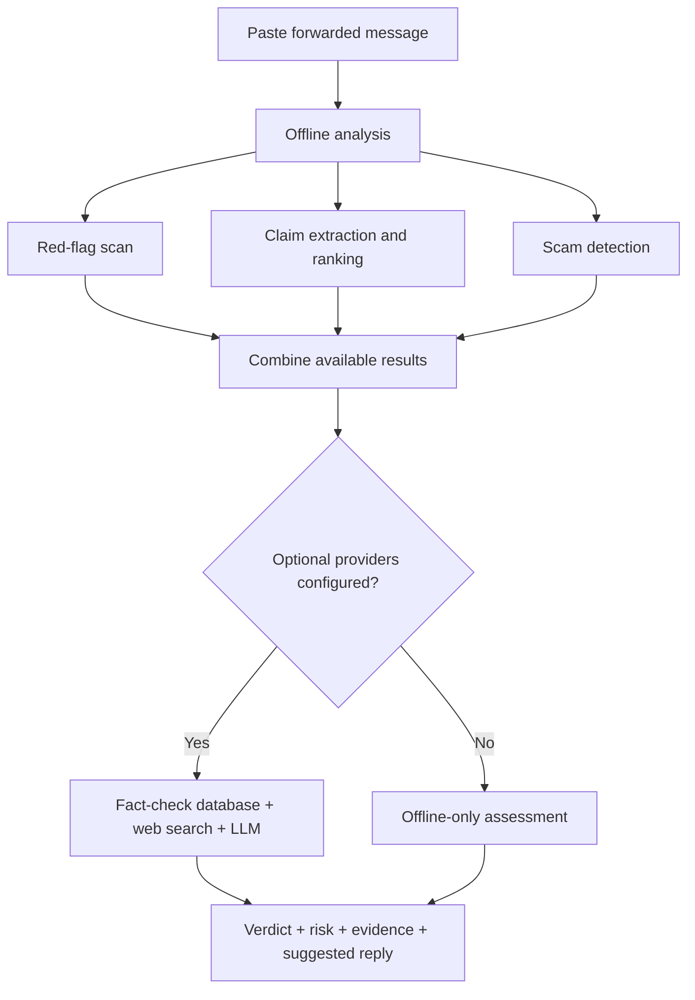

# ForwardCheck

<p align="center">
  
</p>

<p align="center"><strong>Understand a forwarded message before you believe it or pass it on.</strong></p>

<p align="center">
  
  
  
  
</p>

ForwardCheck is a verifier for fake news and forwarded misinformation. Paste a message—the kind that arrives on WhatsApp with “Forwarded many times,” alarming emojis, a fake deadline or no source—and get a red-flag analysis, checkable claims, published fact-checks, cited web evidence and a suggested reply.

It runs on **Cloudflare Workers**. The heuristic engine, claim extraction and scam detection work without network access, accounts or API keys. Optional providers can add evidence and multilingual reasoning.

## How it works



## The key design rule: risk is not proof

The red-flag score describes the **message's language and presentation**—urgency, missing sources, scare tactics and suspicious requests. Wording alone is not evidence, so heuristics alone can only return **unverified**.

Verdict precedence is enforced in `worker/lib/verdict.js`:

1. **Published fact-check match** wins and carries the highest confidence.
2. **Model verdict** is considered next, with confidence adjusted when the model and heuristics disagree.
3. **Heuristics alone** return `unverified`, regardless of how high the risk score is.

A test in `test/verdict.test.js` ensures that no bundled sample is declared false without external evidence.

## Understanding the verdict

| Label | Meaning |
| --- | --- |
| `likely-false` | A fact-check review rated the claim false, or the model found it contradicted. |
| `misleading` | The claim may be technically true but uses the wrong date, place, image or missing context. |
| `unverified` | Available evidence did not settle it. This is not proof that it is true or safe. |
| `likely-true` | A published review supports the claim. |
| `no-claim` | Nothing checkable was found in the message. |

The separate **risk score (0–100)** rates the message itself.

| Score | Risk band |
| ---: | --- |
| 0–24 | Low |
| 25–49 | Caution |
| 50–74 | Elevated |
| 75–100 | High |

The score uses the saturating exponential mapping `100 · (1 − e^(−w/40))`. A mild signal stays low, while several strong signals can raise the score.

## What the offline engine detects

Around 25 explainable signals across six categories report the literal substring that triggered them. Patterns include English, Hinglish and Devanagari.

- **Manipulation:** pressure to forward, fake deadlines, artificial urgency and zero-width/bidirectional characters.
- **Scams:** UPI/payment requests, prize and lottery bait, free-recharge offers, OTP/PIN/KYC solicitation, SIM-blocking threats and shortened links.
- **Health misinformation:** miracle cures, “100% cure” claims and anti-vaccine conspiracy mechanisms.
- **Unverifiable authority:** fake WhatsApp policy claims, government announcements without a named outlet and generic conspiracy framing.
- **Provenance:** “Forwarded many times,” unattributed quotes and claims attributed to unnamed insiders or voice notes.
- **Credibility credits:** named outlets, relevant .gov/WHO/fact-checker links, and a stated date and place. These can reduce the risk score.

## Quick start

Requirements: Node.js and npm.

```bash
npm install
npm test          # Unit and integration tests; no network required
npm run build     # Bundle the Worker and stage deploy artifacts
npm run dev       # Start Wrangler at http://127.0.0.1:8787
```

### Command-line interface

Run the same verification pipeline without a browser:

```bash
node cli.js "Fwd: WhatsApp is going to charge Rs 500 per year!!!"
node cli.js --sample whatsapp-charging
node cli.js --sample hinglish-free-recharge --json
pbpaste | node cli.js
```

The CLI reads keys from environment variables or a local `.dev.vars` file.

## Optional live providers

All providers are optional and independent. If one is missing, its contribution is skipped; the report still returns and indicates which providers contributed.

### LLM reasoning

Adds language detection, translation, claim extraction and multilingual reasoning.

| Variable | Purpose |
| --- | --- |
| `LLM_API_KEY` | API key for an OpenAI-compatible endpoint |
| `LLM_BASE_URL` | Endpoint URL; defaults to `https://api.openai.com/v1` |
| `LLM_MODEL` | Model name |
| `OPENROUTER_FREE` | Any non-empty value enables the server's OpenRouter free-tier option |

UI presets include OpenAI, Groq, Gemini, Anthropic, Mistral, DeepSeek, OpenRouter, xAI, Together and a custom OpenAI-compatible endpoint. The LLM runs after web lookups so it can reason over the evidence.

### Fact-checks and web search

| Variable | Provider | What it adds |
| --- | --- | --- |
| `FACTCHECK_API_KEY` | [Google Fact Check Tools](https://developers.google.com/fact-check/tools/api/reference/rest/v1alpha1/claims/search) | Published ClaimReview lookups |
| `EXA_API_KEY` | [Exa](https://docs.exa.ai/reference/search) | Live web search results and highlights |

### Configure keys

```bash
cp .dev.vars.example .dev.vars
```

Add the relevant values to `.dev.vars` for local development, or configure them as Worker secrets in Cloudflare. Do not commit secrets.

### Bring your own key (BYOK)

Enter a provider and API key in the optional UI model panel. The key is sent with your request and is not stored on the server. It is saved in browser `localStorage` only when **Remember on this device** is enabled.

### OpenRouter free tier

1. Create a key at [OpenRouter API keys](https://openrouter.ai/settings/keys).
2. Select **OpenRouter (Free)** in the UI or set `OPENROUTER_FREE` on the server.

The project's stated free-tier limits are 20 requests/minute and 200 requests/day. Check the provider's current documentation for up-to-date limits.

## API

| Method | Endpoint | Purpose |
| --- | --- | --- |
| `GET` | `/api/health` | Configured providers, capabilities and limits |
| `GET` | `/api/samples` | Example forwarded messages used by the UI |
| `POST` | `/api/verify` | Verify a message and return the full report |

Example request:

```json
{
  "text": "Paste a forwarded message here",
  "useLive": true
}
```

Set `useLive: false` to force offline analysis even when keys are configured. Requests are capped at 20,000 characters.

## Build and deploy

```bash
npm run build
```

The build creates `dist/worker.js`, `dist/public/` and `dist/manifest.json`. Deploy using `dist/manifest.json`. The Worker bundle is a single ES module without imports or Node built-ins; assets are served through `env.ASSETS.fetch` with SPA fallback.

## Interface

The existing interface uses a dark “forensic console” design: near-black backgrounds (`#0B0C0E`), subtle film grain, ambient light, a lime accent (`#D4FF3F`), Space Grotesk display typography and JetBrains Mono for data. Fonts are self-hosted to support the offline-first approach.

Severity uses green → amber → orange → red, based on whichever signal is more severe: the verdict type or risk score. Labels and numeric values communicate severity too, so colour is not the only signal. The design targets at least 4.5:1 contrast for text/background pairs.

## Known limitations

- **Risk is a linguistic heuristic.** A calm, well-formatted lie can score low; a true story written in an alarmist style can score high.
- **Offline mode cannot establish truth.** Without external evidence, the strongest honest result is an unverified verdict plus a risk assessment.
- **Claim extraction is rule-based offline.** LLM-assisted extraction can be stronger but requires a configured provider.
- **Link detection analyses text, not rendered previews.** A scam URL hidden behind a preview may only be detected by its host.
- **Rating normalization is a string mapper.** Unusual fact-check ratings become `unknown` rather than being guessed.
- **The rate limit is per Worker isolate.** It helps with casual abuse but is not a substitute for Cloudflare rate-limiting controls in production.
- **Free providers have usage limits.** Check provider terms and quotas before high-volume use.

ForwardCheck is an aid, not an authority. It can miss context and be wrong. Read linked sources and check the context before acting on a claim or forwarding it.

---

<p align="center"><sub>ForwardCheck · Check before you share.</sub></p>
